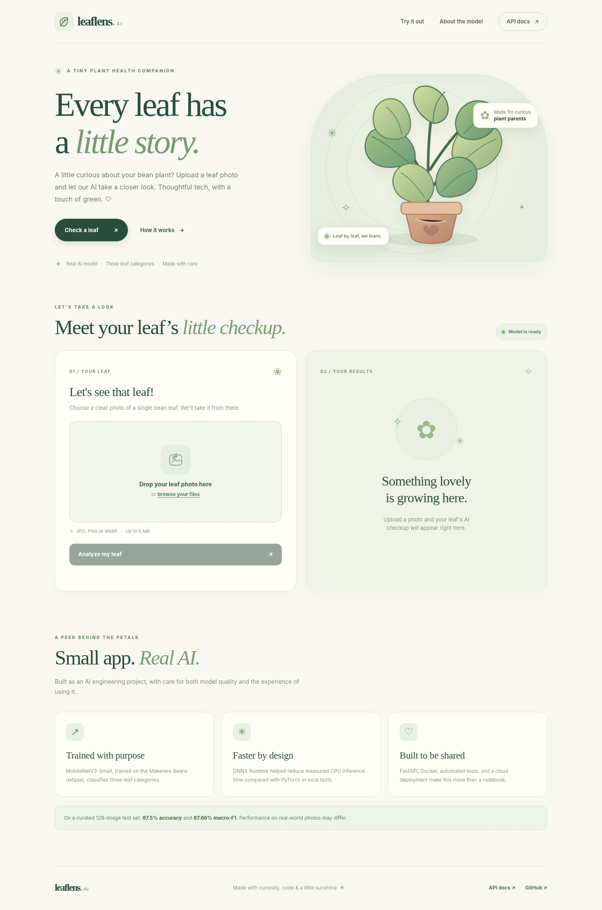
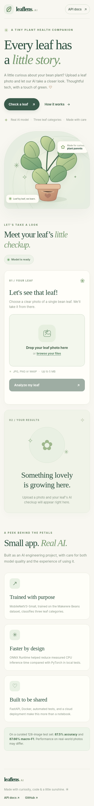

# 🌿 LeafLens AI — Bean Leaf Classification

**An interactive, cloud-hosted computer-vision application built with PyTorch, MobileNetV3-Small, ONNX Runtime, FastAPI, Docker, and GitHub Actions.**

[**🌱 Try the live web app**](https://bean-leaf-classification-api.onrender.com/) · [**API documentation**](https://bean-leaf-classification-api.onrender.com/docs) · [**Model information**](https://bean-leaf-classification-api.onrender.com/model-info)

Upload a bean-leaf photograph to receive one of three classifications: **angular leaf spot**, **bean rust**, or **healthy**, along with model scores. LeafLens pairs a responsive upload interface with a tested inference API and a CPU-optimized ONNX model. Both the frontend and API are served by the **same Dockerized FastAPI application** on Render.

> **Important:** This is an educational/portfolio classifier trained and evaluated on a small curated dataset, **not** a validated agricultural diagnostic system. Model scores are **uncalibrated softmax outputs**, not reliable disease probabilities. Results from local benchmarks should not be interpreted as cloud performance.

## ✨ Web application

- Upload **JPEG, PNG, or WebP** photographs through a responsive drag-and-drop interface, with an image preview.
- View the predicted category and scores for all three classes, with visual progress bars.
- Check readiness, inspect model information, or use the [interactive Swagger UI](https://bean-leaf-classification-api.onrender.com/docs) for direct API access.
- Use the application on a phone or desktop; no installation or API client is required.

### Interface preview

The images below show the UI captured during local interface testing (not a cloud-performance benchmark).

[](https://bean-leaf-classification-api.onrender.com/)

<details>
<summary><strong>View the mobile layout</strong></summary>



</details>

**Live app:** https://bean-leaf-classification-api.onrender.com/  
**REST API:** https://bean-leaf-classification-api.onrender.com/docs

The project is hosted on a **Render Free** web service. After inactivity, the first request may be noticeably slower because the service may need to start.

## Results at a glance

| Measure | Result | Evaluation context |
|---|---:|---|
| **Test accuracy** | **87.50%** | 112 / 128 held-out test images |
| **Test macro-F1** | **87.66%** | Three classes, equal class weighting |
| Best selected-checkpoint validation macro-F1 | 93.24% | 133 validation images; seed 21 |
| ONNX–PyTorch prediction agreement | **133 / 133** | Validation images sent to *both HTTP APIs* |
| Mean model-only CPU latency | 24.85 → **4.77 ms** | PyTorch → ONNX Runtime; 150 runs, 2 configured threads per backend |
| Mean sequential local HTTP latency | 76.02 → **39.39 ms** | PyTorch → ONNX; 150 requests per backend |
| Containerized throughput (concurrency 5) | **58.85 requests/s** | 3,000 requests, localhost through Docker Desktop |
| Containerized test request failures | **0 / 7,500** | Three local load runs at concurrency 1, 5, and 10 |

**Interpreting the speedup:** ONNX was **5.21× faster for model-only inference** and **1.93× faster for mean sequential localhost HTTP responses** in these particular runs. The comparisons are preliminary, not hardware-normalized cloud benchmarks; PyTorch and ONNX server threading settings may differ, and HTTP benchmarks used a single repeated image. See [Performance and limitations](#performance-and-limitations).

Recorded evidence: [`test_metrics_frozen_seed21.json`](results/test_metrics_frozen_seed21.json), [`onnx_validation.json`](results/onnx_validation.json), [`http_equivalence.json`](results/http_equivalence.json), [`backend_benchmark.json`](results/backend_benchmark.json), and [`docker_load_c5.json`](results/docker_load_c5.json).

## Architecture

```text
                      OFFLINE MODEL DEVELOPMENT
Makerere Beans dataset (1,034 train / 133 val / 128 test)
                 │
                 ▼
    MobileNetV3-Small (ImageNet pretrained)
                 │
      Frozen features vs. partial fine-tuning
      Three random seeds per configuration
      Checkpoint selected by validation macro-F1
                 │
                 ▼
     PyTorch checkpoint (not tracked in Git)
                 │
              ONNX export
                 │
                 ▼
    ONNX graph + external weights + metadata
                 │
                 ▼
                      CLOUD INFERENCE SERVICE
Browser (HTML/CSS/JS) ── image upload ──► FastAPI /predict
                                              │
                                   File size/type validation
                                              │
                                   Pillow/NumPy preprocessing
                                              │
                                   ONNX Runtime CPU session
                                              │
                                              ▼
                                 Class label + scores + version
                                              │
                             Browser result UI ◄── JSON response

                  Docker image → Render web service
                  GitHub Actions → CI checks/build
```

The API supports **PyTorch** and **ONNX Runtime** backends for controlled comparisons. The deployed ONNX-only Docker image uses NumPy and Pillow for preprocessing and does **not** install PyTorch. The web interface is static HTML/CSS/JavaScript served from FastAPI, so there is no second frontend hosting bill or cross-origin API configuration.

## Data and modeling

- **Dataset:** [Makerere AI Lab Beans](https://huggingface.co/datasets/AI-Lab-Makerere/beans).
- **Classes:** `angular_leaf_spot`, `bean_rust`, `healthy`.
- **Official splits:** 1,034 train / 133 validation / 128 test images.
- **Model:** ImageNet-pretrained `mobilenet_v3_small`, with a new three-class classification head.
- **Selection criterion:** Highest **validation macro-F1** within each training run. The held-out test set is for final reporting, not hyperparameter selection.

### Controlled training comparison

Frozen-feature training and partial fine-tuning were compared across seeds **42, 7, and 21** (eight epochs, batch size 8, learning rate 0.0001).

| Seed | Frozen features: best val macro-F1 | Partial fine-tuning: best val macro-F1 |
|---|---:|---:|
| 42 | 92.50% | 92.52% |
| 7 | 92.51% | 92.43% |
| 21 | **93.24%** | 93.23% |
| **Mean across seeds** | **92.75%** | **92.73%** |

Partial fine-tuning did **not** show a consistent validation advantage in these experiments, so the frozen-feature **seed-21** checkpoint was selected for serving. Three seeds and a small validation split are insufficient to establish general superiority. See the training histories in [`results/`](results/).

### Held-out test performance and errors

| Class | Precision | Recall | F1 | Support |
|---|---:|---:|---:|---:|
| Angular leaf spot | 83.33% | 81.40% | 82.35% | 43 |
| Bean rust | 80.00% | 83.72% | 81.82% | 43 |
| Healthy | 100.00% | 97.62% | 98.80% | 42 |

Of the **16** mistakes on the 128-image test split, **15** were confusions between angular leaf spot and bean rust. The model performs better on healthy leaves than on distinguishing those two diseases. The test-set result is less favorable than the selected validation result; generalization beyond this small curated dataset is not established.

## Quick start: run the ONNX API in Docker

Requirements: Docker with the engine running. The repository includes the ONNX graph, its **external `.onnx.data` weights**, and the metadata file.

```bash
docker build -f Dockerfile.onnx -t bean-leaf-onnx:local .
docker run --rm -p 8002:8000 bean-leaf-onnx:local
```

Then open the **LeafLens web interface** at [`http://127.0.0.1:8002/`](http://127.0.0.1:8002/) or [Swagger API docs](http://127.0.0.1:8002/docs). To check readiness and send a prediction:

```bash
curl http://127.0.0.1:8002/ready
curl http://127.0.0.1:8002/model-info
curl -X POST http://127.0.0.1:8002/predict -F "file=@sample_leaf.png"
```

A successful prediction includes `label`, `confidence`, `scores`, and `model_version`. **The confidence score is a model softmax output, not a calibrated disease probability.**

### API reference

| Endpoint | Behavior |
|---|---|
| `GET /` | LeafLens AI interactive web interface |
| `GET /health` | Liveness check |
| `GET /ready` | Model readiness; returns `503` if unavailable |
| `GET /model-info` | Loaded model version, classes, architecture and inference backend |
| `POST /predict` | Multipart `file` upload; classification response |

Supported file types: JPEG, PNG, WebP. The API rejects empty, invalid/corrupt, oversized (over 5 MiB), or oversized-pixel-count (over 20 million pixels) images. The softmax scores are not calibrated.

## Development, training, and evaluation

Use a compatible Python environment and install the training dependencies:

```bash
python -m venv .venv
# Windows PowerShell: .venv\Scripts\Activate.ps1
# macOS/Linux: source .venv/bin/activate
python -m pip install -r requirements-training.txt
python -m pip install -r requirements-onnx-api.txt
python -m pytest -q
```

To reproduce the **selected training configuration** (dataset and ImageNet pretrained weights are downloaded automatically):

```bash
python -m scripts.train --epochs 8 --batch-size 8 --lr 0.0001 --seed 21 --output artifacts/beans_frozen_seed21.pt
```

For the corresponding partial fine-tuning experiment, append `--unfreeze-last-block` and choose a different `--output` path. **Training overwrites `results/train_history.json`**; copy it to a run-specific filename after each experiment.

To evaluate a checkpoint (this overwrites the default `results/test_metrics.json` and `results/confusion_matrix.csv`):

```bash
python -m scripts.evaluate --checkpoint artifacts/beans_frozen_seed21.pt
```

The `.pt` checkpoint is intentionally **not included in Git**. To serve or re-export the PyTorch backend, retrain with the command above. For ordinary API use, run the prepackaged ONNX Docker image instead.

## Verification and benchmarking

- **Automated tests:** `python -m pytest -q` covers API validation and the new frontend route/static assets. The original API suite passed eight tests; re-run the current suite and check GitHub Actions after the frontend changes.
- **Backends:** Both APIs matched predicted labels on **133/133 validation images**, with a maximum probability difference of approximately **0.000003** through the HTTP path.
- **Model-only latency:** Compared 150 inferences per backend, excluding image preprocessing and HTTP.
- **HTTP latency:** Compared sequential requests using the same sample image.
- **Load tests:** Containerized API received 1,500 requests at concurrency 1; 3,000 each at concurrency 5 and 10, with zero failures in those runs.

Example local load test against the Docker service:

```bash
python concurrent_http_benchmark.py --url http://127.0.0.1:8002 --image sample_leaf.png --concurrency 5 --runs 3000 --output results/docker_load_c5.json
```

### Performance and limitations

| Docker concurrency | Requests | Throughput | Mean latency | p95 latency | Failures |
|---|---:|---:|---:|---:|---:|
| 1 | 1,500 | 14.13 req/s | 70.66 ms | 90.74 ms | 0 |
| 5 | 3,000 | 58.85 req/s | 84.01 ms | 119.71 ms | 0 |
| 10 | 3,000 | 64.19 req/s | 151.94 ms | 228.43 ms | 0 |

Moving from concurrency **5 to 10** increased throughput by about **9.1%** but increased p95 latency by about **90.8%**: a measurable throughput–latency tradeoff under this workload.

**Benchmark limitations:** Results were measured on a Windows development machine using localhost and, for Docker, Docker Desktop's Linux VM. The exact CPU model, thread allocation across all runs, and system load were not standardized. The same 558 KB image was repeatedly uploaded. These are local performance observations—not service-level objectives, production reliability claims, or cloud performance guarantees.

## Cloud deployment and CI

**Deployment:** Render Web Service using the `Dockerfile.onnx` image, deployed from the GitHub `main` branch. The service serves both the LeafLens homepage at `/` and its JSON prediction endpoint at `/predict`.

**Verified hosted inference:** On **2026-11-25**, a public HTTPS request to the Render `/predict` endpoint returned the same prediction and scores as the locally tested container for `sample_leaf.png`:

```json
{
  "label": "angular_leaf_spot",
  "confidence": 0.812755,
  "scores": {
    "angular_leaf_spot": 0.812755,
    "bean_rust": 0.17215,
    "healthy": 0.015096
  },
  "model_version": "beans-mnv3-seed21"
}
```

Test the **current** live service with:

```powershell
curl.exe https://bean-leaf-classification-api.onrender.com/ready
curl.exe https://bean-leaf-classification-api.onrender.com/model-info
curl.exe -X POST "https://bean-leaf-classification-api.onrender.com/predict" -F "file=@sample_leaf.png"
```

A successful deployed prediction verifies hosted inference; it does not establish uptime guarantees, security hardening, scalability, or production readiness.

**Continuous integration:** GitHub Actions is configured to check Python syntax, install testing/ONNX dependencies, run tests, and build/start the ONNX Docker image with a readiness check. Check the [Actions tab](https://github.com/janaehab/bean-leaf-classification-api/actions) for the latest workflow result.

### Optional: a small cloud latency check

Run the existing benchmark script from your **own computer**, after checking that the Render Free instance is awake. Use a few requests rather than the 7,500-request local load-test workload:

```powershell
python concurrent_http_benchmark.py --url https://bean-leaf-classification-api.onrender.com --image sample_leaf.png --concurrency 1 --runs 10 --warmup 2 --timeout 120 --output results/cloud_latency_sample.json
```

This reports **client-observed end-to-end HTTP latency**, including network overhead, upload, preprocessing, inference, and response serialization. It is **not comparable directly** with the local model-only CPU speedup. Do not claim a measured cloud number until this experiment has actually been run.

### Operational boundaries

The application includes image type, size, and pixel-count checks, a non-root Docker user, health/readiness endpoints, and CI checks. It does **not** claim production-grade security, monitoring, authentication, rate limits, or guaranteed availability. Render Free can sleep when idle and has resource/usage limits. Upload only images you are comfortable sending to the hosted service.

## Repository guide

```text
image_api/                  FastAPI service and PyTorch/ONNX predictors
image_api/frontend/         Responsive LeafLens HTML/CSS/JS web interface
scripts/                    Training, evaluation, export and comparison scripts
tests/                      API and backend tests
artifacts/                  Tracked ONNX graph, external weights and metadata
results/                    Selected model evaluation and benchmark outputs
docs/images/                Local desktop/mobile UI screenshots
docs/onnx-deployment.md     Detailed serving and reproducibility guide
Dockerfile.onnx             CPU-only ONNX serving image
Dockerfile                  Original PyTorch serving image (requires local .pt checkpoint)
concurrent_http_benchmark.py  Concurrent HTTP load testing
.github/workflows/ci.yml    Continuous integration workflow
```

**Technology:** Python · PyTorch / torchvision · MobileNetV3 · ONNX Runtime · FastAPI · NumPy · Pillow · scikit-learn · HTML/CSS/JavaScript · Docker · pytest · GitHub Actions · Render
